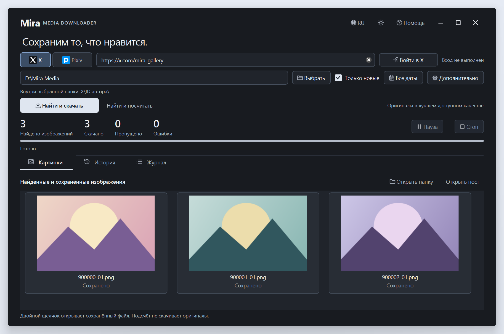

<div align="center">


# Mira Media Downloader

### Сохраним то, что нравится.

Уютная коллекция картинок из X и Pixiv — на вашем компьютере.

**Русский** · [English](docs/README.en.md) · [简体中文](docs/README.zh-CN.md)

**[Скачать для Windows](https://github.com/MerryGrim/MiraMediaDownloader/releases/latest)** · [Быстрый старт](#быстрый-старт) · [Руководство](docs/USER_GUIDE.md)

Windows x64 · Светлая и тёмная темы · Три языка интерфейса

</div>

<picture>
  <source media="(prefers-color-scheme: dark)" srcset="docs/screenshots/main-ru-dark.png">
  <source media="(prefers-color-scheme: light)" srcset="docs/screenshots/main-ru-light.png">
  
</picture>

<p align="center">
  <a href="docs/screenshots/main-ru-dark.png">Тёмная тема</a> · <a href="docs/screenshots/main-ru-light.png">Светлая тема</a>
</p>

*На скриншотах — настоящий интерфейс с демонстрационными изображениями и показателями.*

<details>
<summary>Календарь и всплывающие окна с блюром</summary>


</details>

## Ваша коллекция, под вашим контролем

| | Что умеет Mira |
| --- | --- |
| **Находит, считает, сохраняет** | Скачивает по мере обнаружения. Несколько картинок в одном посте учитываются отдельно. Есть и режим подсчёта без загрузки оригиналов. |
| **Сохраняет качество** | Выбирает лучшее доступное разрешение X и доступные оригиналы страниц иллюстраций и манги Pixiv. |
| **Поддерживает порядок** | Создаёт папки по платформе и числовому ID автора, сохраняет историю и избегает повторов. |
| **Помогает пополнять коллекцию** | Режим «Только новые», пауза, остановка и продолжение с учётом уже сохранённых файлов. |
| **Даёт выбрать нужное** | Своя папка, календарь с диапазоном дат, прогресс, превью и журнал ошибок. |
| **Заботится о мелочах** | Светлая и тёмная темы, скруглённые окна, мягкий блюр диалогов и русский, английский и китайский интерфейс. |

**Основная платформа — X (Twitter). Pixiv остаётся экспериментальным.** Mira сохраняет изображения, доступные вам на площадке; полный архив любого профиля не гарантируется.

## Быстрый старт

1. [Скачайте установщик или переносимый ZIP](https://github.com/MerryGrim/MiraMediaDownloader/releases/latest). Переносимую папку распакуйте целиком, включая `runtime`, и откройте `MiraMediaDownloader.exe`. Отдельная установка Python не нужна.
2. Выберите **X** или **Pixiv** и вставьте ссылку на автора. Корректная ссылка также сама выбирает платформу.
3. Укажите папку коллекции. Если диск D доступен, Mira предлагает хранить картинки там; путь можно изменить.
4. Нажмите **«Войти в X»** или **«Войти в Pixiv»**, завершите вход на странице самого сайта и выберите **«Сохранить вход»**.
5. При необходимости задайте период через **«Все даты»**, затем нажмите **«Найти и скачать»**. При следующих запусках используйте **«Только новые»**.

Счётчик растёт во время поиска; итоговое число известно после завершения полученной выдачи. Превью показывает изображения, уже сохранённые на компьютере.

Установщик проверяет системный Microsoft Visual C++ x64 Runtime и при необходимости предлагает его официальную установку с вашего согласия. Для переносимого варианта нужен тот же компонент. Подробности — в [руководстве](docs/USER_GUIDE.md).

## Вход без лишних шагов

Встроенное окно открывает настоящую страницу X или Pixiv: расширения и ручной экспорт cookies не требуются. Завершите необходимые проверки сайта и сохраните подтверждённую сессию. Mira запрашивает английскую страницу входа; окончательный язык определяет сайт.

**Для Pixiv сначала проверьте [настройки отображения](https://www.pixiv.net/settings/viewing)** и убедитесь, что нужные работы видны тому же аккаунту на сайте. Приложение проверяет вход, но не меняет настройки аккаунта и не снимает ограничения доступа.

В **«Дополнительно»** доступны импорт собственной поддерживаемой браузерной сессии и свой `cookies.txt`. Встроенное окно не поддерживает внешние страницы входа Google/Apple и ключи Windows Hello; варианты и ограничения описаны в [руководстве по авторизации](docs/USER_GUIDE.md#вход-и-границы-доступа).

## Папка, которая остаётся вашей

```text
Ваша коллекция/
├── X/
│   └── <числовой ID автора>/
├── Pixiv/
│   └── <числовой ID автора>/
└── .mira/                    История, задания и журналы
```

Числовой ID сохраняет папку автора при смене имени профиля X. Для переноса коллекции закройте Mira и скопируйте всю папку вместе с `.mira`.

После прерывания выберите тот же профиль, ту же папку и **«Только новые»**. Mira повторит поиск и пропустит уже сохранённые файлы; продолжение с точного места пагинации площадки не обещается.

## Локальные данные и бережные запросы

- Сессии X и Pixiv хранятся раздельно, зашифрованными Windows DPAPI для вашего пользователя. Пароли не сохраняются, данные сессии передаются непосредственно соответствующей площадке.
- Сохранённый вход отделён от коллекции. Файлы сессий и cookies не нужно добавлять в архив картинок или передавать другим людям.
- Запросы выполняются последовательно, с настраиваемым интервалом и ограниченными повторами. Ограничения площадки могут потребовать ожидания.
- Удалённые, закрытые и другие недоступные материалы могут отсутствовать. Видео и анимации Pixiv ugoira не скачиваются. Права на изображения остаются у их владельцев.

## Открытый исходный код

Оригинальный код Mira распространяется под **[GPL-2.0-or-later](LICENSE)** с разрешением на зависимости в [COPYRIGHT](COPYRIGHT). Сторонние компоненты сохраняют свои лицензии.

[Лицензии и соответствующие исходники](docs/LICENSING.md) · [Уведомления зависимостей](THIRD_PARTY_NOTICES.md)

Исходники приложения, библиотек и установщика доступны вместе с [готовыми пакетами Windows](https://github.com/MerryGrim/MiraMediaDownloader/releases/latest).

[Подробное руководство](docs/USER_GUIDE.md) · [Сборка из исходников](docs/BUILDING.md) · [Архитектура](ARCHITECTURE.md)
