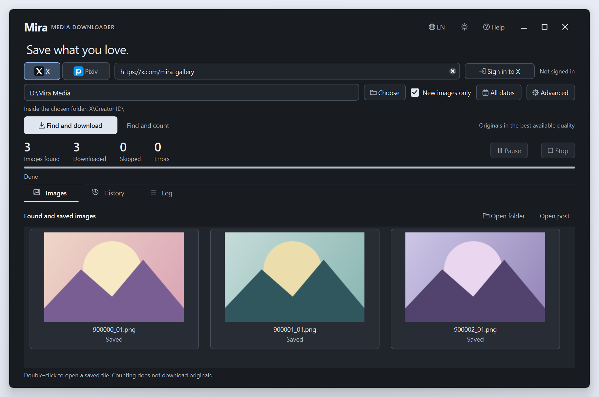

<div align="center">


# Mira Media Downloader

### A little home for the images you love.

A native Windows app for saving images from X (Twitter) and Pixiv to your own collection.

[Русский](../README.md) · **English** · [简体中文](README.zh-CN.md)

**[Download for Windows](https://github.com/MerryGrim/MiraMediaDownloader/releases/latest)** · [Get started](#get-started) · [Detailed guide (Russian)](USER_GUIDE.md)

Windows x64 · Light & dark themes · Русский / English / 简体中文

</div>

<picture>
  <source media="(prefers-color-scheme: dark)" srcset="screenshots/main-en-dark.png">
  <source media="(prefers-color-scheme: light)" srcset="screenshots/main-en-light.png">
  
</picture>

<p align="center">
  <a href="screenshots/main-en-dark.png">Dark theme</a> · <a href="screenshots/main-en-light.png">Light theme</a>
</p>

*Real application screenshots with demonstration images and counters.*

<details>
<summary>Calendar and softly blurred dialogs (Russian interface)</summary>


</details>

## Your collection, your way

| | What Mira does |
| --- | --- |
| **Find, count, save** | Download images as they are discovered, with a separate count for every image in a post. An optional count-only mode is also available. |
| **Keep the best available image** | Save the highest available image quality from X and available original pages from Pixiv illustrations and manga. |
| **Keep things organized** | Choose a storage folder; Mira creates separate folders for each platform and numeric creator ID. |
| **Return for more** | Skip known files with **New images only**, keep local history and checkpoints, and continue after an interruption. |
| **Stay in control** | Calendar date filters, pause and stop controls, progress, saved-image previews and an error log. |
| **Make yourself at home** | Light and dark themes, rounded windows, centered dialogs with a softly blurred background, and three interface languages. |

**X is the main platform. Pixiv is experimental.** Mira saves what the platform makes available to you; it cannot guarantee a complete archive of every profile.

## Get started

1. [Download the installer or portable ZIP](https://github.com/MerryGrim/MiraMediaDownloader/releases/latest). For the portable app, extract and keep the **whole folder**, including `runtime`, then open `MiraMediaDownloader.exe`. Python does not need to be installed separately.
2. Choose **X** or **Pixiv** and paste a creator's profile URL. Mira also recognizes the platform from a valid URL.
3. Choose where to save your collection. If drive D is available, Mira suggests a folder there; you can choose any writable location.
4. Click **Sign in to X** or **Sign in to Pixiv**, finish signing in on the site's own page, then click **Save sign-in**.
5. Set a period under **All dates** if needed, then click **Find and download**. Use **New images only** when returning to the same collection.

The image count grows during the search; the final count is known when it finishes. A post with several images contributes several images to that count. Previews show files already saved locally.

The installer checks the required Microsoft Visual C++ x64 system runtime. If it is missing, Mira offers to download Microsoft's separate installer with your consent. The portable app needs the same component. See the [installation guide (Russian)](USER_GUIDE.md) for details.

## Sign in on the site itself

The built-in sign-in window opens the actual X or Pixiv website. No extension, cookie export or separate browser selection is needed for this method. Complete any CAPTCHA or two-factor check yourself, then save the confirmed session. Mira requests the English sign-in page; the site has the final say over its language.

**For Pixiv, check your [viewing settings](https://www.pixiv.net/settings/viewing) first.** Make sure the desired artworks are visible to the same account on Pixiv. Mira checks that you are signed in, but does not change account settings or unlock restricted content.

**Advanced** also lets you import your own supported browser session locally or select your own `cookies.txt` file. Protected browser sessions may be unavailable. The built-in window does not support external Google/Apple sign-in pages or Windows Hello passkeys. The [detailed guide (Russian)](USER_GUIDE.md) covers alternatives and troubleshooting.

## A folder that stays yours

```text
Your collection/
├── X/
│   └── <numeric creator ID>/
├── Pixiv/
│   └── <numeric creator ID>/
└── .mira/                    Local history and job logs
```

Numeric IDs keep an author's folder consistent even if their X username changes. To move the collection and its history, close Mira and copy the entire collection folder, including `.mira`.

After an interruption, use the same profile, the same storage folder and **New images only**. Mira searches again and skips known completed files; resuming an exact platform pagination position is not guaranteed.

## Local sessions, considerate requests

- Saved X and Pixiv sessions are separate and protected by Windows DPAPI for your Windows account. Passwords are not stored. Session credentials go directly to the corresponding platform, not to the developer or an analytics service.
- Sessions are stored separately from your image collection. Keep cookie files and session files private; sign in again when moving to another computer or Windows account.
- Requests run sequentially, with an adjustable delay and limited retries. Platform rate limits may require a wait or a later retry.
- Deleted, private, restricted or otherwise unavailable media can be missing. Videos and Pixiv ugoira animations are not downloaded. Mira does not bypass access controls.

Only save material you are authorized to access and use. Downloaded artwork remains subject to its owners' rights.

## Open source

Mira's original code is **GPL-2.0-or-later**, with the dependency permission in [COPYRIGHT](../COPYRIGHT). Dependencies retain their own licenses.

[License](../LICENSE) · [Third-party notices](../THIRD_PARTY_NOTICES.md) · [Licensing and corresponding source](LICENSING.md)

Application source, dependency source and installer source are available alongside the [Windows downloads](https://github.com/MerryGrim/MiraMediaDownloader/releases/latest). For development, see [building from source](BUILDING.md) and the [architecture](../ARCHITECTURE.md).
