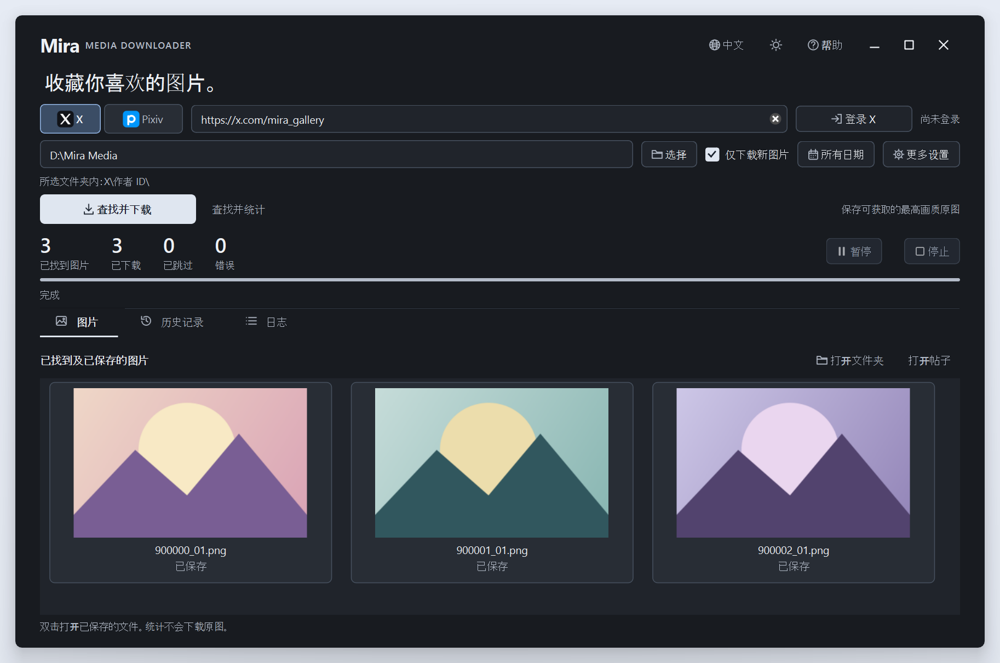
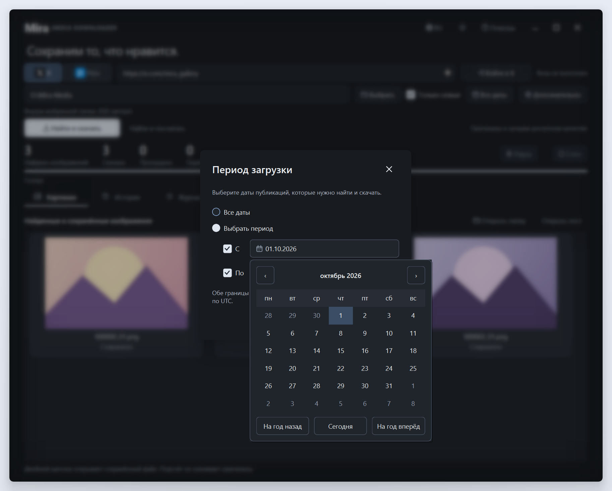
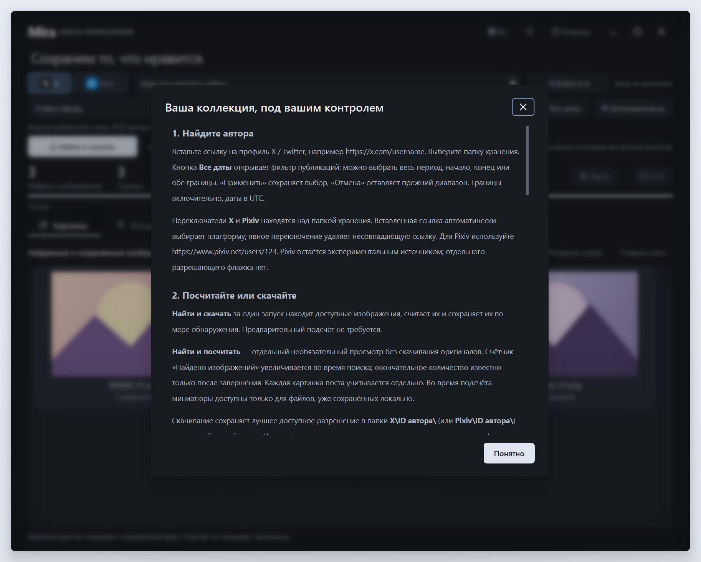

<div align="center">


# Mira Media Downloader

### 把喜欢的图片，收藏在自己的电脑里。

适用于 Windows 的桌面图片下载工具 · X（Twitter）与 Pixiv

[Русский](../README.md) · [English](README.en.md) · **简体中文**

**[下载应用](https://github.com/MerryGrim/MiraMediaDownloader/releases/latest)** · [开始使用](#开始使用) · [详细指南（俄语）](USER_GUIDE.md)

Windows x64 · 浅色与深色主题 · 俄语 / 英语 / 简体中文

</div>

<picture>
  <source media="(prefers-color-scheme: dark)" srcset="screenshots/main-zh-CN-dark.png">
  <source media="(prefers-color-scheme: light)" srcset="screenshots/main-zh-CN-light.png">
  
</picture>

<div align="center">

[查看深色主题](screenshots/main-zh-CN-dark.png) · [查看浅色主题](screenshots/main-zh-CN-light.png)

</div>

*截图展示真实应用界面，图片和统计数据均为演示内容。*

<details>
<summary>日历与背景虚化弹窗（俄语界面）</summary>





</details>

简洁的原生界面，搭配浅色与深色主题、圆角窗口、日历筛选器和柔和的弹窗背景虚化。应用及安装程序均提供俄语、英语和简体中文。

## 它能做什么

- **边查找，边下载。** 一次任务即可查找、统计并保存图片，也可以只统计数量，不下载原图。同一帖子或作品中的多张图片会分别计数和保存。
- **保留最佳可用画质。** 下载平台提供的原图或最佳可用分辨率，不用模糊缩略图替代原图。
- **只收集新图片。** 通过历史记录和校验信息避免重复下载，文件按平台和作者数字 ID 自动归档。
- **随时暂停、继续。** 提供进度、已保存图片的预览、历史记录和错误日志；任务状态保存在本地。
- **自己决定范围。** 自选保存文件夹，通过日历设置发布日期范围；请求间隔可以调整。
- **直接在应用内登录。** 打开平台真实的登录网页，无需浏览器扩展或手动导出 cookies。

**X 是主要支持的平台，Pixiv 支持仍处于实验阶段。** Mira 以可获取的最佳分辨率保存平台实际返回的图片，不保证能取得每个作者的完整图库。

图片总数会在查找过程中逐步更新，完成后才是此次返回结果中的最终数量。平台可能限制历史记录，计数不代表作者曾发布过的全部图片。

## 开始使用

1. 从[下载页面](https://github.com/MerryGrim/MiraMediaDownloader/releases/latest)获取安装程序或便携压缩包。便携使用时请解压并保留整个应用文件夹，包括 `runtime`，然后运行 `MiraMediaDownloader.exe`。无需另外安装 Python；系统组件说明见[使用指南](USER_GUIDE.md)。
2. 选择 **X** 或 **Pixiv**，粘贴作者主页链接，例如 `https://x.com/username` 或 `https://www.pixiv.net/users/123`。有效链接也会自动选择平台。
3. 选择保存文件夹。有可用的 D 盘时，Mira 会优先建议在 D 盘保存，路径可以自由更改。
4. 点击 **登录 X** 或 **登录 Pixiv**，在平台网页中完成登录和必要验证，然后点击 **保存登录状态**。
5. 按需设置 **所有日期** 中的日历范围，点击 **查找并下载**。再次收藏同一作者时，可使用 **仅下载新图片** 跳过已经保存的内容。

如果只想知道能找到多少张图片，使用 **查找并统计**。预览来自已经保存在电脑上的文件；仅统计时不会额外下载原图。

## 登录与 Pixiv 设置

登录发生在 X 或 Pixiv 自己的网页中，Mira 不读取密码或验证码输入框。登录窗口优先请求英文页面；实际语言由网站决定。请使用平台密码登录，并手动完成验证码和双重验证。应用内窗口不支持 Google、Apple 等外部登录，也不支持 Windows Hello 通行密钥。

也可以在 **更多设置** 中导入自己的浏览器会话，或选择自己的 `cookies.txt` 文件。部分浏览器的会话保护会阻止读取；Mira 不会绕过这些保护。操作方法和兼容限制见[使用指南](USER_GUIDE.md)。

**使用 Pixiv 前，请先在同一账号的[显示设置](https://www.pixiv.net/settings/viewing)中开启自己有权查看的内容，并确认作品可以在网站上正常打开。** Mira 不会修改账号设置，也不会解除年龄或其他访问限制。登录后等待验证，必要时点击 **检查登录状态**，确认成功后再保存；访客会话不能代替账号登录。

Pixiv 可保存平台实际返回的插画、漫画各页原图。视频和 ugoira 动画不在下载范围内；无法取得原图的作品会被跳过并记入日志。

## 图片保存在哪里

选择一个收藏文件夹，Mira 会在其中创建以下目录：

```text
你的收藏文件夹/
├── X/
│   └── 作者数字 ID/
├── Pixiv/
│   └── 作者数字 ID/
└── .mira/
    ├── history.sqlite3
    ├── logs/
    └── tasks/
```

作者文件夹使用数字 ID，X 用户改名后仍使用同一目录。隐藏的 `.mira` 保存历史、任务状态和校验信息；搬移收藏时，请关闭 Mira 后连同它一起复制。

任务中断后，选择相同链接和收藏文件夹，再以仅下载新图片模式启动。Mira 会重新查找并跳过已保存的内容，不保证从平台原有的分页位置直接续接。未完成的图片会重新下载并检查完整性。

## 隐私与访问范围

- 保存的登录状态由当前 Windows 用户的 DPAPI 加密，X 与 Pixiv 的会话分开存放。会话直接用于请求对应平台，不会交给开发者或第三方分析服务；密码不会写入本地会话文件。
- 收藏、历史记录和设置保存在本机。公开的应用包、源码和演示截图不包含用户 cookies、真实账号会话或个人收藏。
- Mira 只处理公开可访问或你的账号依法可访问的内容。私密、删除、地区限制或其他受限内容可能无法获取；即使成功登录，也不保证能取得完整图库。
- 网络请求按顺序执行，并设有间隔与有限重试。遇到限流时，请等待或增大请求间隔；访问限制不会被绕过。
- 下载图片的权利仍属于原作者及其他权利人。请遵守适用法律、平台规则及作者的使用条件。

## 文档与许可

[完整使用指南（俄语）](USER_GUIDE.md) · [源码运行与构建（英语）](BUILDING.md) · [架构说明](../ARCHITECTURE.md)

Mira 的原创代码采用 **[GPL-2.0-or-later](../LICENSE)**，并附有 [COPYRIGHT](../COPYRIGHT) 中的依赖使用许可；软件按许可证规定不提供保证。第三方组件保留各自的许可条款，详见[第三方声明](../THIRD_PARTY_NOTICES.md)和[许可与对应源码说明](LICENSING.md)。应用与依赖的对应源码可从[下载页面](https://github.com/MerryGrim/MiraMediaDownloader/releases/latest)获取。
